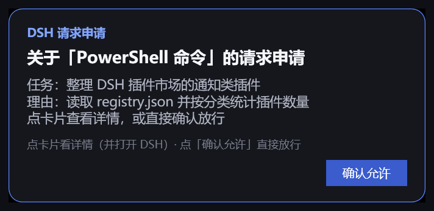
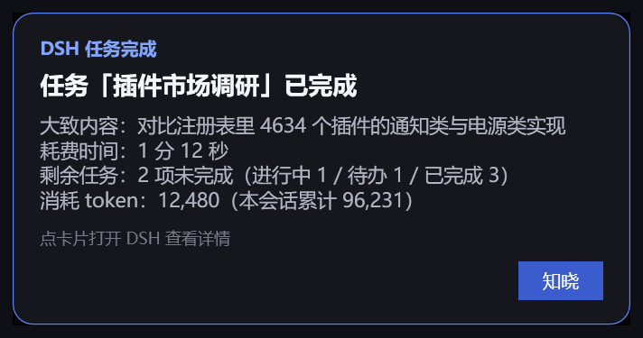
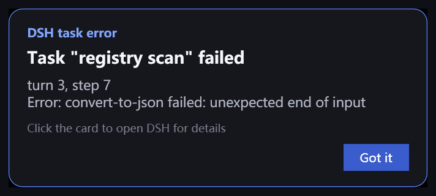
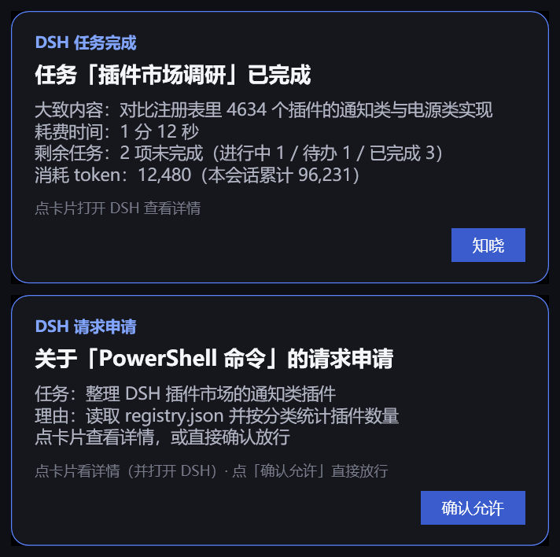

# dsh-desk-card

**DSH（DeepSeek Harness）**的右下角原生桌面卡片：审批请求、提问、任务完成、任务报错。

卡片不是系统通知，而是由 PowerShell/WPF 自绘的小窗口（始终置顶），因此卡片上可以带一个
真正能「回答请求」的按钮：审批可以直接在卡片上放行。而在会打扰你的时候（全屏应用、游戏、
勿扰模式）卡片直接跳过，把决定权交回 DSH 界面。

仅 Windows。零依赖、不联网、无需构建。

## 为什么不用系统 Toast

| | 系统通知 | 本卡片 |
|---|---|---|
| 带一个能返回结果的按钮 | 取决于系统/额外运行时 | 可以，按钮是卡片自己画的 |
| 直接在通知上放行审批 | 不行（只能把应用拉到前台） | 可以：`确认允许` / `Allow` |
| 尊重全屏游戏与勿扰模式 | 只能靠系统压掉 | 画窗口之前先过闸门 |
| 文案语言 | 系统决定 | 跟随 DSH 语言，也可用 `language` 固定 |

## 截图









## 运行要求

- Windows 10/11（卡片用 `powershell.exe` + WPF 绘制，系统自带）。
- DSH 桌面版 profile（卡片由**宿主**进程注入，不需要浏览器侧挂件）。
- Node.js 20+（DSH 自带的即可）。

## 安装

从本仓库安装：

```sh
dsh plugin --profile desktop add github:nanshang328/dsh-desk-card
```

或用本地目录：

```sh
dsh plugin --profile desktop add ./dsh-desk-card
```

然后重启 DSH。包里声明了 `dsh.bundle`，CLI 会把它记进 `dsh.profile.bundles` 并作为一个普通的
profile 层挂载，不需要手写任何绝对路径。

Windows 开发辅助脚本：`powershell.exe -File tools/deploy-local.ps1` 会把工作区复制到
`%USERPROFILE%\.dsh\profiles\desktop\plugins\dsh-desk-card` 并用同样的方式注册。

## 会出现哪些卡片

| 卡片 | 触发时机 | 自动关闭 | 按钮 |
|---|---|---|---|
| 审批 | 某个工具调用需要授权 | 不关（等你处理） | `确认允许` 直接放行一次 · 点卡片打开 DSH 看完整对话框 |
| 提问 | agent 需要你回答 | 不关，直到问题被回答 | `知道了` |
| 完成 | 一轮正常结束 | `doneTimeoutSeconds`（默认 5 秒） | `知晓` |
| 报错 | 一轮失败 | 不关 | `知道了` |

完成卡片还会带上你最后一条消息的摘要、本轮耗时、剩余待办数量，以及本轮/本会话的 token 消耗。

卡片之间不会重叠：新卡片会叠在已有卡片的上面。DSH 窗口关掉时，还开着的卡片会一起关闭。

## 配置

所有配置都有内置默认值，这一节可以完全不看。要改动，就在你自己的 profile
`cordis.patch.yml`（`~/.dsh/profiles/desktop/cordis.patch.yml`）里加一条同 id 的行：

```yaml
- insert:
    - id: dsh-desk-card
      name: dsh-desk-card
      config:
        doneTimeoutSeconds: 10
        scale: 1.0
        language: en
```

只写你要改的键即可：`config` 对象是整体替换的，没写的键会回落到下面的默认值。

| 键 | 默认 | 含义 |
|---|---|---|
| `timeoutSeconds` | `0` | 需要**你**处理的卡片（审批/提问）的自动关闭秒数，`0` = 一直留着 |
| `doneTimeoutSeconds` | `5` | 完成卡片的自动关闭秒数，`0` = 一直留到点击 |
| `scale` | `1.2` | 卡片缩放 |
| `skipWhenFullscreen` | `true` | 全屏应用在前台、或系统处于勿扰模式时跳过卡片 |
| `notifyQuestions` | `true` | 是否显示提问卡片 |
| `notifyErrors` | `true` | 是否显示报错卡片 |
| `notifyDone` | `true` | 是否显示完成卡片 |
| `language` | `auto` | `auto`（跟随 DSH 语言）/ `zh` / `en` |
| `hostProcess` | `DeepSeek Harness` | 点卡片时被拉到前台的进程名 |

三个 `notify*` 开关只控制「卡片显不显示」，审批与提问链路始终照常工作。

### 全屏闸门

满足任一条件就不画卡片：

- `SHQueryUserNotificationState` 报告全屏应用、演示模式或勿扰；或
- 前台窗口铺满它所在的显示器，且不是桌面（应对隐藏了真实状态的全屏游戏）。

卡片被跳过后，审批会交回 DSH 原来的界面（本插件以 `prepend: true` 先说话，被跳过时一定
`next()` 交回下游），不会卡住。不用开游戏也能复现：

```powershell
powershell.exe -File test/gate-probe.ps1 -MaxSeconds 20          # 观察闸门 blocked -> free
powershell.exe -File test/fake-fullscreen.ps1 -HoldSeconds 8     # 画一个 8 秒的全屏窗口
```

## 工作原理

```
lib/index.js      宿主侧：监听 approval/request、user-questions/request、agent/error、
                  agent/status；每个事件起一张卡片，并把卡片进程的退出码翻译成审批结果。
scripts/card.ps1  渲染侧：一张卡片一个 PowerShell 进程。先过闸门，再画 WPF 窗口、
                  叠到兄弟卡片上方、跑计时器，最后用退出码把结果告诉宿主侧。
```

两半之间的退出码协议：

| 退出码 | 含义 |
|---|---|
| `10` | 按下了卡片的主按钮 |
| `12` | 点击了卡片正文——把 DSH 窗口拉到前台，交给界面处理 |
| `0` | 闸门跳过了卡片（全屏 / 勿扰） |
| `3` | 渲染失败 |

一张卡片一个进程，渲染侧因此完全无状态：卡片不可能拖死宿主，被系统杀掉的卡片等价于
「交给界面处理」。

## 日志与排查

`%TEMP%\dsh-desk-card.log` 会记录卡片位置、退出码、配置与闸门判定：

```
apply() started config={"skipWhenFullscreen":true,...}
showCard[approval]: exit 10
approval resolved: allowed-once
done card (41234ms, autoClose=5s)
```

卡片进程没有控制台窗口。如果一直不弹卡片，依次检查：全屏应用占着闸门（手动测试可加
`-SkipWhenFullscreen false`）、DSH 进程的 PowerShell 被策略拦了、最后看日志文件。

手动渲染一张卡片（完全绕过宿主侧）：

```powershell
$payload = [Convert]::ToBase64String([Text.Encoding]::UTF8.GetBytes('{"badge":"test","head":"hello","body":"line","okLabel":"OK","okCode":10}'))
powershell.exe -File scripts/card.ps1 -Payload $payload -TimeoutSeconds 5 -Scale 1.2 -SkipWhenFullscreen false -DebugLog "$env:TEMP\card-test.log"
```

## 已知限制

- 仅 Windows：渲染侧是 PowerShell + WPF，没有 macOS/Linux 实现。
- 卡片是普通的顶层窗口，能盖住其他窗口，但盖不住独占全屏的游戏——这正是闸门存在的原因。
- 一张卡片一个 PowerShell 进程（冷启动约 100ms）。卡片不是通知中心条目，关掉就没了。
- 本插件**不做**重启/关机。要电源控制请用
  [dsh-power-button](https://github.com/keyiadiannao/dsh-power-button) 或
  [dsh-restart](https://github.com/anweat/dsh-restart)。

## 隐私

宿主侧不开任何网络端口、不读任何文件：每张卡片起一个本地 PowerShell 进程，并往
`%TEMP%\dsh-desk-card.log` 追加一行。卡片内容包含会话的短摘录（任务标题、工具名、审批理由、
错误信息），以命令行参数的形式传给那个子进程。

## 许可证

MIT
